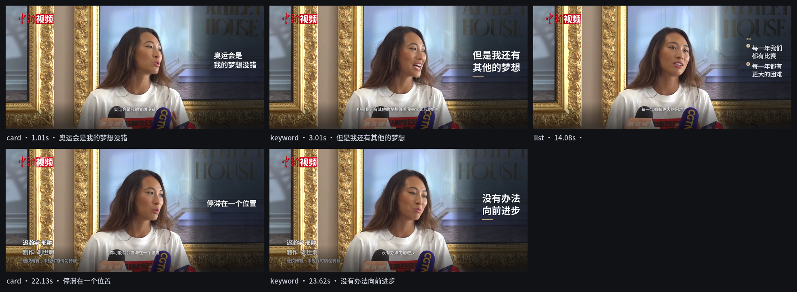

# Semantic Motion

**A Claude Code skill that turns a raw talking-head video into a finished, publishable
video with semantic motion graphics — and proves it didn't ruin the shot.**

Upload one clip. The agent transcribes it, aligns every character to the audio, sees the
person (silhouette, face, hands, burned-in credits), decides which ideas deserve a graphic,
composes that graphic beside the speaker, burns in captions, verifies the result on the
rendered pixels, and hands you back an MP4 plus an editable engineering file.



## The output

| file | what it is |
|---|---|
| `final.mp4` | deliverable — original picture and audio, overlays and captions burned in |
| `motion_ir.json` | **editable** Motion IR (every element: window, box, type, motion, content) |
| `captions.srt` / `.ass` / `.json` | frame-accurate captions |
| `storyboard.png` | one frame per element, labelled |
| `qa_metrics.json` | objective checks with raw numbers |
| `final_overlay.mp4`, `final_ink.mp4` | attribution passes used by QA |
| `run_summary.json` | everything needed to reproduce the run |

## Install

macOS 14+ with `ffmpeg`, Python 3.11+.

```bash
git clone <this repo> "Semantic Motion" && cd "Semantic Motion"
uv venv --python 3.12 .venv && uv pip install --python .venv/bin/python -r requirements.lock
python3 scripts/install_skill.py          # copies the skill into ~/.claude/skills and ~/.dsh/skills
```

The skill is also live from this checkout: `.dsh/skills/semantic-motion/SKILL.md`.

## Use

```bash
export PYTHONPATH=src
.venv/bin/python -m semotion.pipeline run --video talk.mp4 --out out/talk --draft   # seconds
.venv/bin/python -m semotion.pipeline run --video talk.mp4 --out out/talk           # deliverable
```

The pipeline runs: probe → ASR (local faster-whisper) → character alignment → Apple Vision
perception → anchors/decisions → design → render (with captions) → QA.

Directing is where taste enters, and it is a **model decision, not a rule**:

```bash
# host agent decides (no API key): measure -> brief -> agent authors decisions -> render
.venv/bin/python -m semotion.pipeline run --video talk.mp4 --out out/talk --brief-only
.venv/bin/python -m semotion.pipeline run --video talk.mp4 --out out/talk \
    --decisions out/talk/decisions.json

# or any OpenAI-compatible endpoint decides
SM_LLM_BASE_URL=... SM_LLM_API_KEY=... SM_LLM_MODEL=... \
  .venv/bin/python -m semotion.pipeline run --video talk.mp4 --out out/talk --director llm
```

`director_brief.json` contains measured facts only (anchor ids, exact times, features,
context); the model may only reference those ids, so it cannot invent timing. Decisions
are validated: unknown anchors, out-of-order lists, or a number the speaker did not say
are rejected with a reason. All thresholds (density, margins, type scale, motion, caption
rules) live in [`policies/smart_balanced.json`](policies/smart_balanced.json) and are
recorded in the IR; `--policy` overrides them. See [docs/LLM-DIRECTOR.md](docs/LLM-DIRECTOR.md).

## Architecture

```
src/semotion/
  pipeline.py     one command: all stages, artifacts, summary
  asr.py          faster-whisper wrapper (local, cached)
  align.py        char-level alignment on the onset envelope (monotonic DP)
  forced.py       acoustic CTC forced alignment (XLSR-53 zh / letter CTC en), optional model
  captions.py     segment-respecting cues, ≤2 lines, SRT/ASS
  perception.py   Apple Vision: person mask, pose, hands, burned-in text, quiet zones
  anchors.py      semantic anchor extraction (v1 rules) + LLM span helpers
  design2.py      director + layout solver (silhouette bands, treatments, type scale)
  effects2.py     procedural elements: keyword/card/list/stat/barchart/compare/quote
  theme2.py       palette sampling, type scale, wrapping (jieba), gradients, easing
  render2.py      deterministic single-pass compositor (Pillow → ffmpeg), 3 passes
  verify2.py      QA on rendered frames: occlusion, text, contrast, layout, timing
  repair.py       deterministic repairs (relocate/shrink/scrim/retime/drop)
  ir.py, verify.py   v1 contracts (kept for compatibility)
docs/             DESIGN, PERCEPTION-CONTRACT, PERCEPTION, QA, ALIGNMENT, INTERFACES
.dsh/skills/semantic-motion/   the skill (SKILL.md + references)
delivery/          reference renders
reports/           gate reports and the final report
artifacts/         all evidence (QA JSON, masks, metrics, storyboards)
```

## Measured quality (this repo's runs)

Real footage: CC BY 3.0 interview clip (Wikimedia Commons, 1920×920, 25 s, 625 frames).

| check | result |
|---|---|
| face / person occlusion | 0 px / 0 px (measured on rendered frames against Apple Vision masks) |
| burned-in text collision | 0 px over protected credits |
| contrast (WCAG) | min 6.43 : 1 |
| timing | 0-frame onset error on all 5 elements (25 fps) |
| ink on the anchor frame | present on frame 0 for all 5 elements |
| layout margins | ≥48 px (2.5 % of width) |
| determinism | two renders, 625/625 frames, mean \|Δ\| = 0.0 |
| alignment | pooled P90 7.56 ms on TTS truth (n=147); real speech monotonic, median syllable 150 ms |

Full numbers and honest caveats: [`reports/FINAL-REPORT.md`](reports/FINAL-REPORT.md).

## Honest limits

* Timing truth is **synthetic** (TTS fixtures). Real human speech has no labelled corpus
  here. The envelope aligner wins that synthetic metric by construction (a TTS splice is an
  energy jump); on real speech the CTC aligner agrees with Whisper word starts at a median
  50 ms vs 150 ms, which is why `--aligner auto` prefers CTC when its model is cached.
  Neither is human-verified.
* Apple Vision is **macOS-only**; on other platforms perception degrades to face boxes and
  the layout gets conservative.
* Body pose returns nothing on tight head-and-shoulders crops; masks still carry the
  silhouette, hands are sparse.
* Aesthetics are not machine-verified. Contrast/timing/margins/coverage are.
* `barchart`/`compare` render numbers you supply; nothing is inferred from the video.

## License / provenance of test footage

The demo uses a Wikimedia Commons clip (CC BY 3.0) trimmed by the v1 pipeline; attribution
in `reports/licenses.md`. Fonts: Noto Sans SC and Inter (OFL).
